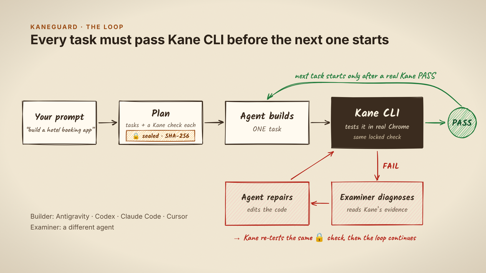

# KaneGuard: your coding agent builds it. Kane CLI proves it.

**KaneGuard closes the loop between AI coding agents and Kane CLI.** Describe an app in plain English. A coding agent plans it into small tasks, each with its own Kane CLI browser check, locked with a SHA-256 fingerprint before any code is written. The agent builds **one task at a time**, and Kane CLI tests each task in real Chrome before the next one starts. When Kane fails, a second agent reads Kane's evidence and diagnoses the bug, the builder repairs the code, and Kane re-runs **the exact same locked check**. Only a real Kane PASS counts, and every failure stays on record.

Built for the **Kane CLI Online Hackathon (TestMu AI), November 2026.**

**▶ Demo video (2:50):** https://www.youtube.com/watch?v=bV0_ikv3xwo



---

## Run it in 30 seconds

**Prerequisites:** Node.js 20+ on Linux, macOS, or Windows with WSL2. KaneGuard has **zero npm dependencies**, so there is no `npm install`.

```bash
git clone https://github.com/kushalsourav/kaneguard
cd kaneguard
bash scripts/start.sh
```

Open **http://127.0.0.1:4173/control/**. The start script lists which tools it found (Kane CLI and each coding agent) and starts the Studio.

For real builds you also need [Kane CLI](https://www.testmuai.com/support/docs/kane-cli-introduction/) (signed in) plus **at least one** coding agent:

```bash
# Kane CLI: independent browser verification (required)
npm install -g @testmuai/kane-cli
kane-cli login

# Then any ONE (or more) of these coding agents:
curl -fsSL https://cursor.com/install | bash && agent login   # Cursor
npm install -g @openai/codex && codex                         # Codex
# Claude Code: https://code.claude.com/docs/en/setup           # then: claude
# Google Antigravity CLI: https://antigravity.google/docs/cli/headless/   # then: agy
```

Review remote install scripts before running them. Sign-in is handled by each vendor.

---

## Try it

1. **Create → New app.** Type a request, e.g. *"Build a shopping cart with Notebook $18, Pen $5 and Bag $32, quantity controls, coupon SAVE10 for 10% off orders of $50+, and localStorage."*
2. Pick a **builder** (Antigravity, Codex, Claude Code or Cursor) and an **examiner** (a different agent).
3. Watch the **Live loop**: the plan, the agent's edits, Kane's browser steps as they stream in, and every FAIL → diagnosis → repair → retest.
4. When it finishes, open the **App** tab to use what was built, and the **Trust Receipt** for the full evidence.

You can **Stop** a run at any time (it ends both the coding agent and Kane CLI), and **Continue** it later with the same plan and locked checks.

---

## How the loop works

```text
Prompt
  → Plan: tasks + one Kane CLI check per task, each sealed with SHA-256
  → Agent builds ONE task
  → Kane CLI runs that task's check in real Chrome
        PASS → next task
        FAIL → examiner diagnoses from Kane's evidence
             → builder repairs the code
             → Kane re-runs the SAME locked check
  → Final suite: every check re-verified on the finished app
  → Verdict + Trust Receipt (every pass and every failure)
```

**What keeps it honest**

- **Locked checks.** Every Kane objective is fingerprinted with SHA-256 before coding and re-checked before every Kane run, so the agent can't quietly rewrite a test to pass.
- **Independent examiner.** A second agent reviews every Kane FAIL and plans the fix. The builder never grades its own work.
- **Only a real Kane PASS counts.** Agent claims, syntax checks and "task complete" messages never mark a task verified.
- **Every failure stays on record.** Original FAILs, diagnoses, repairs and retests all stay in the run history, the Trust Receipt and TestMu Test Manager.
- **Kane slips are handled honestly.** If the app is already correct, Kane re-runs the same check once. If Kane, the examiner and the diagnosis all agree a check contradicts the request, it is corrected once, re-sealed as v2, and must still pass Kane for real. A check that can't be proven is reported as **unproven**, never as passed, and the rest of the build carries on.
- **Distinct outcomes.** `passed`, `failed`, `verification_inconclusive`, `interrupted` and `infrastructure_error` are never merged.

---

## Real example: CartLedger

The demo video shows this run, end to end:

- **Builder:** Antigravity · **Examiner:** Codex · **Blind builder:** on (the builder never saw the exact check wording)
- **4 tasks · 4 Kane checks · 10 Kane browser runs**
- **Kane caught a real bug.** "Add to cart" was visible and enabled, but clicking it, pressing Enter or pressing Space left the cart at zero. Codex diagnosed it from Kane's evidence (no click handler or cart state), Antigravity repaired `app.js` and `style.css`, and Kane re-ran the same locked check: **PASS**.
- **Verdict: passed.** 9/9 requirements proven, 2 Kane failures fixed by the repair loop, 0 unproven.
- The finished app matches the spec: 2 Notebooks + 1 Bag with SAVE10 gives **$66.10**, the exact total Kane verified.

Run records live in `runs/` on the machine that executed them. They are Git-ignored and **not bundled** in the repository.

---

## Existing projects

**Create → Existing app** connects a local npm-driven frontend (Next.js, Vite, React, Vue, Nuxt, Astro…):

1. **Browse** to the project folder (the picker is limited to your home folder) or paste its path.
2. Describe the change, e.g. *"Add a dark mode toggle that is remembered after reload"*.
3. Confirm the detected framework and start command. KaneGuard starts the app's own `dev`/`start` script on a local port, the agent edits the project **in place**, and Kane tests the real running app.

KaneGuard never runs `npm install` or changes your npm scripts, and **Disconnect** never deletes source. Commit or back up first, because edits are made in place. In the demo, KaneGuard added a dark-mode toggle to an existing React app and Kane verified it in both themes.

---

## Evidence you can inspect

| Where | What |
|---|---|
| **Live loop** | Plan → Build → Kane test → Diagnose → Repair → Verdict, with agent actions and Kane steps |
| **Trust Receipt** (`/api/runs/<id>/receipt`) | The request, every SHA-256 sealed check, the requirement matrix and the full Kane history |
| **TestMu Test Manager** | Each Kane run, step by step, with the browser replay |
| **Raw evidence** (`runs/<id>/`) | Kane NDJSON, agent transcripts, diffs and the live log |

---

## Repository map

```text
engine/            agent adapters, planner, Kane CLI runner, examiner, repair loop, seals
server/main.mjs    local server: Studio, project, run and evidence APIs
public/control/    the Studio UI (Create, Projects, Live loop)
public/app-*/      apps generated by KaneGuard (local only)
configs/           project settings
scripts/start.sh   one-command start with tool detection
tests/             automated tests (stand-in CLIs, not real browser results)
docs/CHANGELOG.md  full version history
```

## Tests and maintenance

```bash
npm test          # automated tests with stand-in agent/Kane CLIs (no Kane credits used)
npm run doctor    # environment check
npm start         # same server as scripts/start.sh
```

Recording a demo? `KANEGUARD_KANE_HEADED=1 bash scripts/start.sh` makes Kane drive a visible Chrome window.

## Scope and safety

KaneGuard is a **local developer tool**. The server binds to `127.0.0.1`; don't expose it to the internet. Agents run with your user permissions, with edits limited to the app's own source files and KaneGuard's engine and evidence protected. New apps are plain HTML/CSS/JS; connected apps may include their own server code (e.g. Next.js API routes). Desktop Kane runs don't claim mobile-width verification. Run records can contain your prompts and local paths, so review them before sharing.

## Links

- [Kane CLI docs](https://www.testmuai.com/support/docs/kane-cli-introduction/)
- [Cursor CLI](https://cursor.com/docs/cli/installation) · [Codex CLI](https://github.com/openai/codex) · [Claude Code](https://code.claude.com/docs/en/setup) · [Antigravity CLI](https://antigravity.google/docs/cli/headless/)
